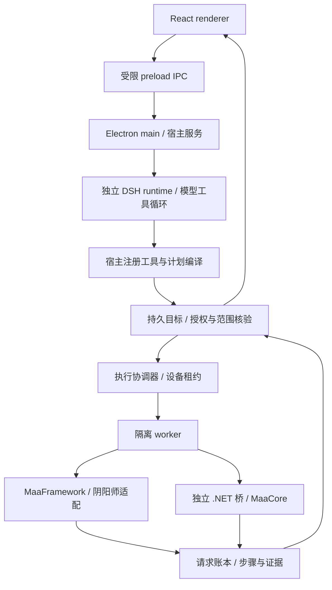

# Architecture

本文描述 GamePilot 0.15.13 的源码结构。项目将模型推理、执行准入、原生控制和结果核验分开；模型不能直接持有设备控制权。

## 进程与职责

- `apps/desktop/renderer` 只显示状态和发送受限 IPC；没有 Node 或直接原生调用。
- `apps/desktop/main` 管理配置、聊天、计划、Goal、调度、账本和设备协调。主进程不加载 Maa 原生引擎。
- `packages/runtime` 拥有引擎调用与 worker 生命周期。MaaFramework 通过 `@maaxyz/maa-node` 加载；MaaCore 由独立 C# / .NET 进程调用。
- `games` 定义游戏能力、参数语义、执行适配、恢复条件和完成证据。平台公共计划不直接暴露任意 Maa Pipeline 或脚本执行。
- CLI / MCP 接入同一宿主控制服务，不建立第二套设备执行器。

## 模型与权限

固定 DeepSeek Harness SDK 运行时负责工具循环和持久会话。GamePilot 的可信 Cordis 插件提供模型桥和受限工具集合；不向模型开放任意 shell、终端或进程工具。

每个 App 用户 turn 使用独立推理会话键，同轮工具循环及一次允许的 followup 共用该键和预算。完整聊天、Goal 和账本保留；宿主提供有界历史及最多 8 KiB 的目标事实。超额目标详情要求读取 `read_goal`，不会截断范围限制后继续授权。执行权限始终取当前用户消息及宿主审核，旧目标范围和旧回执仅是事实。

当前模型循环受工具次数、模型请求次数和时间限制。SDK 原生上下文压缩未启用，也没有通过额外模型摘要生成新的权限。

## 受理、执行与结果

编译结果包含冻结范围及指纹。真正执行前，宿主重新核对当前授权、账号配置、游戏日、原请求历史、资源限制和设备租约。保存日常、自定义子集和续跑不能互相冒充完整日常。

模型回复结束、请求受理、原生流程结束、目标满足是四个独立事实。结果从匹配原范围的任务记录和证据重建；未提交、已提交但未知、失败、跳过和完成分别保留。合法结束处理不会把历史 unknown 改写成成功。

当前聊天消息优先显示属于同一会话、同一 turn 的 Goal 实时结果。前置查询记录折叠为历史参考；普通只读查询仍显示其查询证据。

## 设备与恢复

设备动作由唯一协调器持有租约。MuMu 实例通过管理器信息及实际端口绑定，避免仅凭 ADB 显示名猜测实例。

原生调用有界；超时后不能将发出 kill 等同于实际退出。未确认退出的 worker 保留设备隔离，相关读取与执行入口也须遵守隔离。

恢复受原目标、当前账号证明、业务提交边界和宿主注册能力限制，并有最多两次的额度上限。额度不表示所有异常都可恢复。未知账号、未知业务效果、客户端更新或缺少可靠进度证据不能自动转成重复执行；通用 MuMu 崩溃恢复并不因此被宣称已完成。

## 状态与资源

正式应用数据位于当前用户的 `.gamepilot` 目录；源码构建产物、测试证据和下载缓存在被忽略的 `dist` / `artifacts` 中。公开仓库不带用户状态。

根依赖与 DSH runtime 各有独立锁文件。MaaCore、OCR 及独立 Node 的版本和校验信息由相应脚本或契约固定。游戏视觉模板未包含在纯源码首发中。构建和打包不等于完成第三方二进制再分发审计，详见 [第三方说明](third-party-notices.md)。
